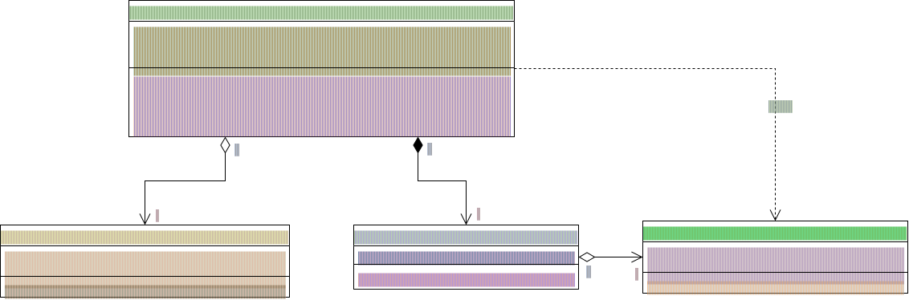

# Vertiefungsaufgabe 08 - Assoziationen

## Ausgangslage

Du wurdest beauftragt, die Software für das Sursee-Museum neu zu programmieren.

## Das Museum

Ein Museum hat mehrere Ausstellungsräume (`Rooms`) in denen Ausstellungsstücke (`Exhibits`) ausgestellt werden. Besucher kommen in das Museum, um die Ausstellungsstücke anzusehen.

## Aufgaben

### Beantworte folgende Fragen

- a) Beziehung Museum – Visitor:
  - Wie heisst dieser Beziehungstyp? 1 zu mehrere (Assoziation)
  - Wieso wurde dieser Beziehungstyp gewählt? Ein Museum kann zu einem Zeitpunkt mehrere Besucher haben, während ein Besucher flexibel eintreten und gehen kann.
  - Wie und wo wird diese Beziehung im Programm realisiert? Über eine Liste von `Visitor`-Objekten in der Klasse `Museum` (Eigenschaft `Visitors` sowie Methoden wie `AddVisitor` und `RemoveVisitor`).
- b) Beziehung Museum – Room
  - Wie heisst dieser Beziehungstyp? 1 zu mehrere (Komposition, erkennbar an der gefüllten Raute)
  - Wieso wurde dieser Beziehungstyp gewählt? Ein Museum besteht aus mehreren Räumen; die Räume sind fest an das Existieren des Museums gebunden.
  - Wie und wo wird diese Beziehung im Programm realisiert? Über eine private Liste von `Room`-Objekten (`_rooms`) in der Klasse `Museum` und die Methode `AddRoom`.
- c) Beziehung Raum – Exhibit
  - Wie heisst dieser Beziehungstyp? 1 zu mehrere (Aggregation, erkennbar an der nicht gefüllten Raute)
  - Wieso wurde dieser Beziehungstyp gewählt? Ein Raum kann mehrere Ausstellungsstücke beinhalten, aber Exponate können logisch auch unabhängig existieren oder zugewiesen werden.
  - Wie und wo wird diese Beziehung im Programm realisiert? Über die Eigenschaft `Location` (Typ `Room`) in der Klasse `Exhibit`.
- d) Zähle die Attribute mit Typ in den Klassen auf:
  - `Visitor`: `LastName: string`, `FirstName: string`
  - `Museum`: `_rooms: Room[*]`, `Name: string`, `Visitors: Visitor[*]`
  - `Room`: `RoomLabel: string`
  - `Exhibit`: `Label: string`, `Location: Room [0..1]`
- e) Beschreibe, wie dem Museum ein neuer Raum hinzugefügt wird.
  - Durch den Aufruf der Methode `AddRoom(string roomLabel)` auf der `Museum`-Instanz, welche intern einen neuen `Room` instanziiert und der Liste `_rooms` hinzufügt.

### Implementation

Implementiere das Museum, verstaue in einer Program-Klasse ein paar Ausstellungsstücke und lass Besucher kommen und gehen.
