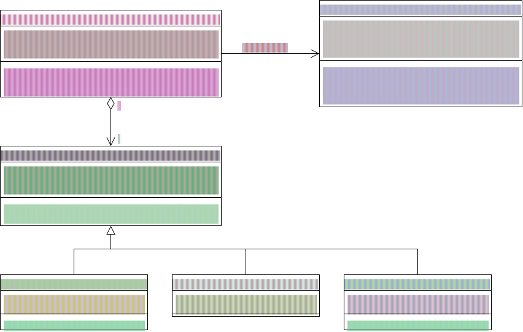

# Vertiefungsaufgabe 09 - Polymorphismus

## Ausgangslage

Die Bösewichte (`Villains`) haben entdeckt, dass sie allein keine Chance haben gegen die Geheimagenten (`Agents`). Also stelle nun deine Schergen (`Henchmen`) zusammen, die dann in grosser Zahl über die Geheimagenten herfallen und ihnen den Garaus machen sollen.

In diesem Auftrag lernst du, wie Bösewichte Polymorphismus verwenden, um ihre Handlanger einfach zu verwalten.

## Aufgabenstellung

Implementiere das Projekt.



Es folgt ein Beispielsprogramm:

```csharp
Villain blofeld = new Villain("Blofeld");
Agent bond = new Agent("James Bond");
blofeld.Archenemy = bond;
blofeld.AddHenchman(new Thug("Beisser"));
blofeld.AddHenchman(new Killer("Xenia"));
blofeld.AddHenchman(new Hacker("Boris"));
blofeld.SendHenchmenOnAgent();
```

### Hinweise zur Implementierung

- Villain:
  - `SendHenchmenOnAgent`: Ruft der Reihe nach von jedem Henchman die `Attack`-Methode auf. Wenn am Ende der Geheimagent ausser Gefecht (`incapacitated`) ist, dann gibt die Methode eine Sieges-Nachricht aus. Wenn nicht, dann gibt sich der Bösewicht geschlagen.
- Henchman:
  - `Attack`: Ruft erst die `GetHit`-Methode des Geheimagenten auf und gibt als Argument den eigenen Schaden (`Damage`) mit. Dadurch erleidet der Geheimagent soviel Schaden wie der Scherge austeilen soll. Im Anschluss wird die `Attack`-Methode des Geheimagenten aufgerufen und der zurückgegebene Wert wird von den eigenen Lebenspunkten (`Hitpoints`) abgezogen.
- Thug:
  - `Attack`: Ein Thug greift nicht nur einmal an, sondern so lange, bis er keine Hitpoints mehr hat! Solange die Hitpoints grösser als 0 ist, werden `GetHit` und `Attack` des Geheimagenten aufgerufen.
- Hacker:
  - `Attack`: Ein Hacker macht keinen Schaden wenn er angreift, sondern verringert den Schaden, den der Geheimagent austeilt, permanent um 1. Wie er das macht? Keine Ahnung...

### Zusatzaufgaben

- Entwickle dein Programm so weiter, dass der Angriff läuft, bis eine Seite gewonnen hat. Ausgeschaltete Henchmen sollen darum aus der Liste entfernt werden, damit sie den Geheimagenten nicht mehr angreifen können. Dann wird geschaut, ob erst der Geheimagent ausgeschaltet ist oder es keine Henchmen mehr hat, die aktionsfähig sind.
- Designe neue Henchmen mit eigenen Angriffs-Methoden: Ninjas, Dynamit-Spezialist, Zombie, o.ä.
