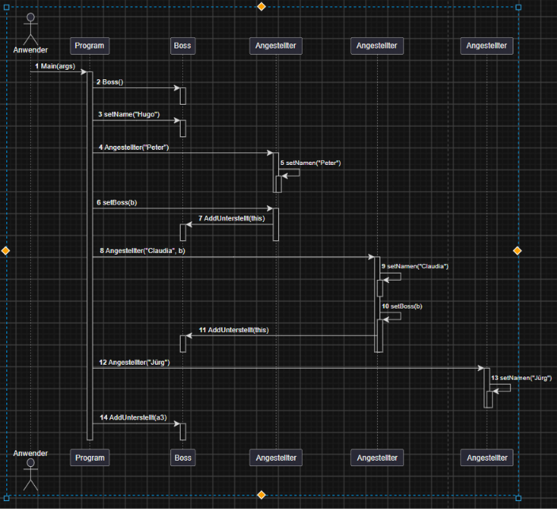
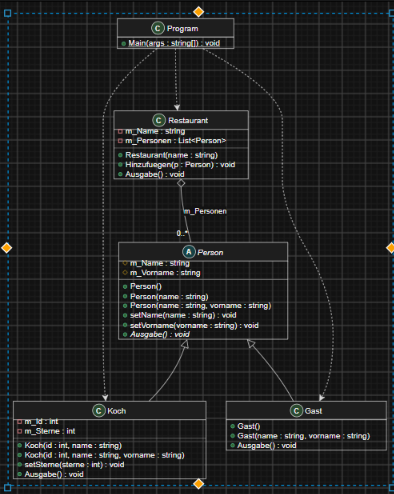
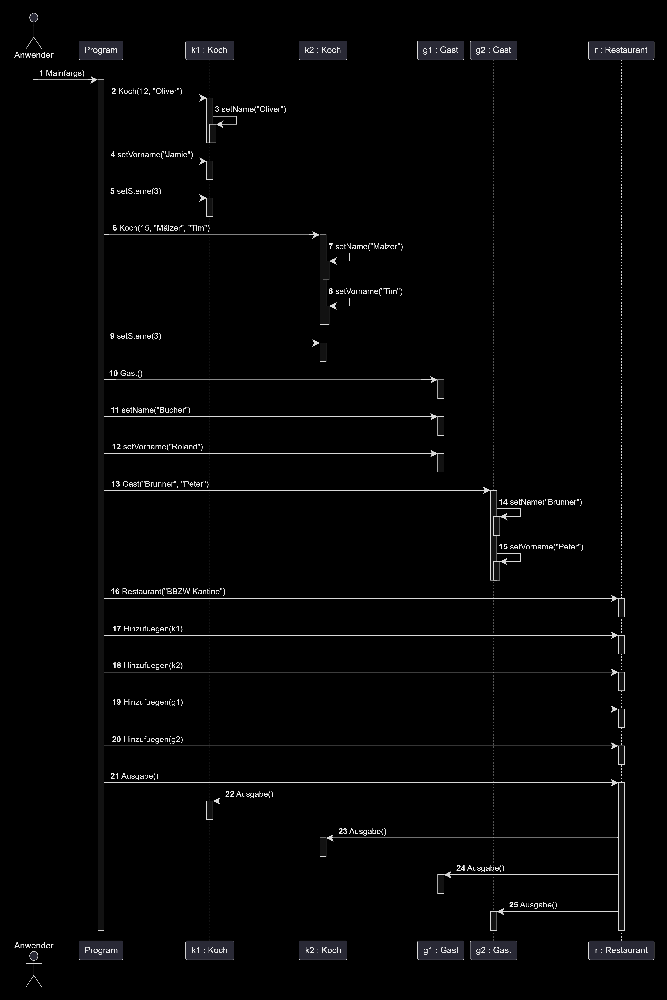

**Markdown**

```
# Vertiefungsaufgabe 13 - UML Sequenzdiagramm

## Aufgabe 1

Visualisiere das dynamische Verhalten der Applikation in dem du das Sequenzprogramm erstellst. Aufrufe von Bibliotheksmethoden (z.B. Console.WriteLine() ) müssen nicht dargestellt werden. Das Diagramm soll den Aktor "Anwender" und die Objekte "Programm", "Boss" und drei Lebenslinien für "Angestellter" aufweisen.


```


```csharp
class Program
{
    static void Main(string[] args)
    {
        Boss b = new Boss();
        b.setName("Hugo");
        Angestellter a1 = new Angestellter("Peter");
        a1.setBoss(b);
        Angestellter a2 = new Angestellter("Claudia", b);
        Angestellter a3 = new Angestellter("Jürg");
        b.AddUnterstellt(a3);
    }
}
```


**C#**

```
public class Boss
{
    //Membervariablen
    private string m_Name;

    private List<Angestellter> m_Unterstellte = new List<Angestellter>();

    //Methoden
    public void setName(string s)
    {
        m_Name = s;
    }

    public void AddUnterstellt(Angestellter a)
    {
        m_Unterstellte.Add(a);
    }
}
```

**C#**

```
public class Angestellter
{
    //Membervariablen
    private string m_Name;

    //Konstruktoren
    public Angestellter(string s)
    {
        setNamen(s);
    }

    public Angestellter(string s, Boss b)
    {
        setNamen(s);
        setBoss(b);
    }

    //Methoden
    public void setNamen(string s)
    {
        m_Name = s;
    }

    public void setBoss(Boss b)
    {
        b.AddUnterstellt(this);
    }
}
```

### Lösung Aufgabe 1

**Code-Snippet**

```
@startuml
skinparam style strictuml
autonumber

actor Anwender
participant "Program" as Prog
participant "Boss" as Boss
participant "Angestellter" as A1
participant "Angestellter" as A2
participant "Angestellter" as A3

Anwender -> Prog : Main(args)
activate Prog

Prog -> Boss : Boss()
activate Boss
deactivate Boss

Prog -> Boss : setName("Hugo")
activate Boss
deactivate Boss

Prog -> A1 : Angestellter("Peter")
activate A1
A1 -> A1 : setNamen("Peter")
activate A1
deactivate A1
deactivate A1

Prog -> A1 : setBoss(b)
activate A1
A1 -> Boss : AddUnterstellt(this)
activate Boss
deactivate Boss
deactivate A1

Prog -> A2 : Angestellter("Claudia", b)
activate A2
A2 -> A2 : setNamen("Claudia")
activate A2
deactivate A2
A2 -> A2 : setBoss(b)
activate A2
A2 -> Boss : AddUnterstellt(this)
activate Boss
deactivate Boss
deactivate A2
deactivate A2

Prog -> A3 : Angestellter("Jürg")
activate A3
A3 -> A3 : setNamen("Jürg")
activate A3
deactivate A3
deactivate A3

Prog -> Boss : AddUnterstellt(a3)
activate Boss
deactivate Boss

deactivate Prog
@enduml
```

## Aufgabe 2

Erstelle den Programmcode, das Klassendiagramm und das Sequenzdiagramm für das folgende Programm:

**C#**

```
class Program
{
    static void Main(string[] args)
    {
        Koch k1 = new Koch(12, "Oliver");
        k1.setVorname("Jamie");
        k1.setSterne(3);
        Koch k2 = new Koch(15, "Mälzer", "Tim");
        k2.setSterne(3);
        Gast g1 = new Gast();
        g1.setName("Bucher");
        g1.setVorname("Roland");
        Gast g2 = new Gast("Brunner", "Peter");
        Restaurant r = new Restaurant("BBZW Kantine");
        r.Hinzufuegen(k1);
        r.Hinzufuegen(k2);
        r.Hinzufuegen(g1);
        r.Hinzufuegen(g2);
        r.Ausgabe();
        Console.ReadLine();
    }
}
```

Programmausgabe:

**Plaintext**

```
------------------------------
         BBZW Kantine
------------------------------
Koch: <3 Sterne> Jamie Oliver
Koch: <3 Sterne> Tim Mälzer
Gast: Roland Bucher
Gast: Peter Brunner
```

### Lösung Aufgabe 2

#### Programmcode

**C#**

```
public abstract class Person
{
    //Membervariablen
    protected string m_Name;
    protected string m_Vorname;

    //Konstruktoren
    public Person()
    {
    }

    public Person(string name)
    {
        setName(name);
    }

    public Person(string name, string vorname)
    {
        setName(name);
        setVorname(vorname);
    }

    //Methoden
    public void setName(string name)
    {
        m_Name = name;
    }

    public void setVorname(string vorname)
    {
        m_Vorname = vorname;
    }

    public abstract void Ausgabe();
}
```

**C#**

```
public class Koch : Person
{
    //Membervariablen
    private int m_Id;
    private int m_Sterne;

    //Konstruktoren
    public Koch(int id, string name) : base(name)
    {
        m_Id = id;
    }

    public Koch(int id, string name, string vorname) : base(name, vorname)
    {
        m_Id = id;
    }

    //Methoden
    public void setSterne(int sterne)
    {
        m_Sterne = sterne;
    }

    public override void Ausgabe()
    {
        Console.WriteLine($"Koch: <{m_Sterne} Sterne> {m_Vorname} {m_Name}");
    }
}
```

**C#**

```
public class Gast : Person
{
    //Konstruktoren
    public Gast() : base()
    {
    }

    public Gast(string name, string vorname) : base(name, vorname)
    {
    }

    //Methoden
    public override void Ausgabe()
    {
        Console.WriteLine($"Gast: {m_Vorname} {m_Name}");
    }
}
```

**C#**

```
public class Restaurant
{
    //Membervariablen
    private string m_Name;
    private List<Person> m_Personen = new List<Person>();

    //Konstruktor
    public Restaurant(string name)
    {
        m_Name = name;
    }

    //Methoden
    public void Hinzufuegen(Person p)
    {
        m_Personen.Add(p);
    }

    public void Ausgabe()
    {
        Console.WriteLine("------------------------------");
        Console.WriteLine($"         {m_Name}");
        Console.WriteLine("------------------------------");

        foreach (Person p in m_Personen)
        {
            p.Ausgabe();
        }
    }
}
```

#### Klassendiagramm

**Code-Snippet**

```
@startuml
skinparam classAttributeIconSize 0

class Program {
  + {static} Main(args : string[]) : void
}

class Restaurant {
  - m_Name : string
  - m_Personen : List<Person>
  + Restaurant(name : string)
  + Hinzufuegen(p : Person) : void
  + Ausgabe() : void
}

abstract class Person {
  # m_Name : string
  # m_Vorname : string
  + Person()
  + Person(name : string)
  + Person(name : string, vorname : string)
  + setName(name : string) : void
  + setVorname(vorname : string) : void
  + {abstract} Ausgabe() : void
}

class Koch {
  - m_Id : int
  - m_Sterne : int
  + Koch(id : int, name : string)
  + Koch(id : int, name : string, vorname : string)
  + setSterne(sterne : int) : void
  + Ausgabe() : void
}

class Gast {
  + Gast()
  + Gast(name : string, vorname : string)
  + Ausgabe() : void
}

Program ..> Restaurant
Program ..> Koch
Program ..> Gast
Restaurant o-- "0..*" Person : m_Personen
Person <|-- Koch
Person <|-- Gast
@enduml
```

#### Sequenzdiagramm

**Code-Snippet**

```
@startuml
skinparam style strictuml
autonumber

actor Anwender
participant "Program" as Prog
participant "k1 : Koch" as K1
participant "k2 : Koch" as K2
participant "g1 : Gast" as G1
participant "g2 : Gast" as G2
participant "r : Restaurant" as Rest

Anwender -> Prog : Main(args)
activate Prog

Prog -> K1 : Koch(12, "Oliver")
activate K1
K1 -> K1 : setName("Oliver")
activate K1
deactivate K1
deactivate K1

Prog -> K1 : setVorname("Jamie")
activate K1
deactivate K1

Prog -> K1 : setSterne(3)
activate K1
deactivate K1

Prog -> K2 : Koch(15, "Mälzer", "Tim")
activate K2
K2 -> K2 : setName("Mälzer")
activate K2
deactivate K2
K2 -> K2 : setVorname("Tim")
activate K2
deactivate K2
deactivate K2

Prog -> K2 : setSterne(3)
activate K2
deactivate K2

Prog -> G1 : Gast()
activate G1
deactivate G1

Prog -> G1 : setName("Bucher")
activate G1
deactivate G1

Prog -> G1 : setVorname("Roland")
activate G1
deactivate G1

Prog -> G2 : Gast("Brunner", "Peter")
activate G2
G2 -> G2 : setName("Brunner")
activate G2
deactivate G2
G2 -> G2 : setVorname("Peter")
activate G2
deactivate G2
deactivate G2

Prog -> Rest : Restaurant("BBZW Kantine")
activate Rest
deactivate Rest

Prog -> Rest : Hinzufuegen(k1)
activate Rest
deactivate Rest

Prog -> Rest : Hinzufuegen(k2)
activate Rest
deactivate Rest

Prog -> Rest : Hinzufuegen(g1)
activate Rest
deactivate Rest

Prog -> Rest : Hinzufuegen(g2)
activate Rest
deactivate Rest

Prog -> Rest : Ausgabe()
activate Rest
Rest -> K1 : Ausgabe()
activate K1
deactivate K1
Rest -> K2 : Ausgabe()
activate K2
deactivate K2
Rest -> G1 : Ausgabe()
activate G1
deactivate G1
Rest -> G2 : Ausgabe()
activate G2
deactivate G2
deactivate Rest

deactivate Prog
@enduml
```
